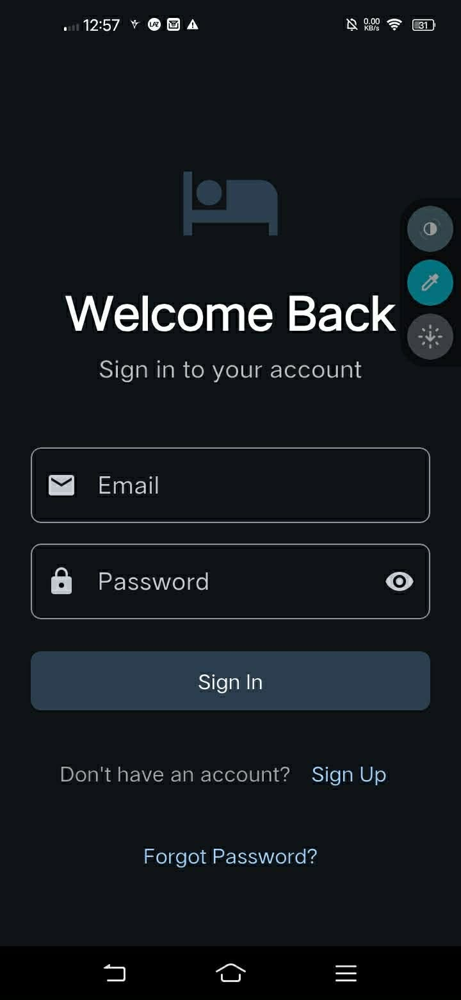
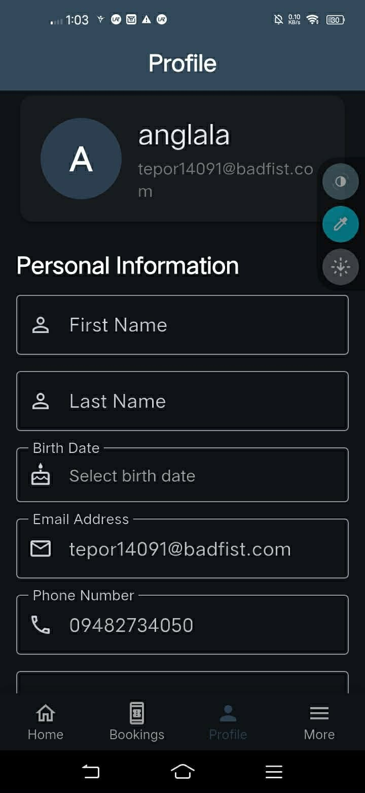

# Hotel Booking System v2 
 
Modern hotel booking system with Flutter mobile app and Flask backend. 
3rd Year Project 2025-2026

GROUP:
Full stack Developer: Marco Ronquillo
Tester/Analysts: Paula Talabis
Document: Princess Joy Bituin
Document: kristina Ebit Martos

<h2>System Screenshots</h2>

<table>
  <tr>
    <th>Homepage</th>
    <th>Login</th>
    <th>Hotel Details</th>
    <th>Booking</th>
  </tr>
  <tr>
    <td></td>
    <td></td>
    <td></td>
    <td></td>
  </tr>
  <tr>
    <th>Check</th>
    <th>Payment</th>
    <th>Profile</th>
    <th>Settings</th>
  </tr>
  <tr>
    <td></td>
    <td></td>
    <td></td>
    <td></td>
  </tr>
</table>

### 7. User Profile

### 8. Settings Page

